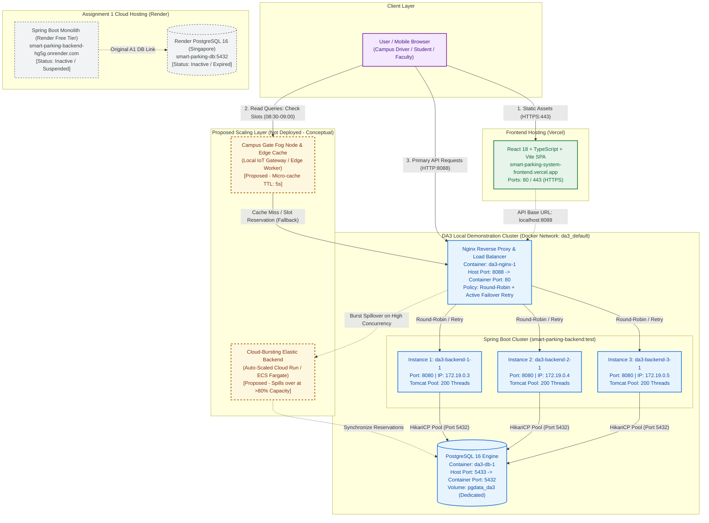

# DA3 Q1.D System Architecture & Cloud Scaling Specification

**Project:** Smart Parking Slot Reallocation System  
**Course:** BACSE344 — Cloud Infrastructure and Architecture (Digital Assignment 3)  
**Branch:** `feature/scaling-security`  
**Date:** 2026-10-27  

---

## 1. System Architecture Diagram

The diagram below illustrates the end-to-end architecture of the Smart Parking Slot Reallocation System, incorporating the existing cloud lineage (Vercel and Render), the local multi-container DA3 cluster (Nginx, 3 Spring Boot instances, PostgreSQL), and the **proposed (not deployed)** Edge/Fog and Cloud-Bursting scaling tier.



---

## 2. Architecture Legend & Component Categorization

| Visual Identifier | Architecture Tier | Components Included | Operational Status |
| :--- | :--- | :--- | :--- |
| **Solid Purple Border** | **Client Layer** | User / Mobile Browser (Campus drivers, students, faculty) | Active / Production |
| **Solid Green Border** | **Deployed Cloud Frontend** | React 18 + TypeScript + Vite SPA on Vercel | Active / Production |
| **Solid Blue Border** | **Local DA3 Cluster** | Nginx (`8088:80`), 3x Spring Boot backends (`8080`), PostgreSQL 16 (`5433:5432`) on `da3_default` | **Implemented & Verified** |
| **Dashed Grey Border** | **Assignment 1 Cloud Lineage** | Render Web Service & Render PostgreSQL 16 (`smart-parking-db`) | Historical / Suspended |
| **Dashed Amber Border** | **Proposed Scaling Extension** | Campus Gate Fog Node & Edge Micro-Cache + Cloud-Bursting Worker Pool | **Proposed (Conceptual / Not Deployed)** |

---

## 3. Verified Component Details & Port Mapping

| Component | Container / Host Name | Network & IP | Host Port | Internal Port | Role & Configuration |
| :--- | :--- | :--- | :---: | :---: | :--- |
| **Nginx Load Balancer** | `da3-nginx-1` | `da3_default`<br>`172.19.0.6` | **`8088`** | `80` | Reverse proxy, round-robin load distribution, `proxy_next_upstream` failure failover retry policy, `X-Served-By` response header. |
| **Backend Instance 1** | `da3-backend-1-1` | `da3_default`<br>`172.19.0.3` | None | `8080` | Spring Boot 3.3.4, Java 21, Tomcat embedded server, HikariCP pool connected to `db:5432`. |
| **Backend Instance 2** | `da3-backend-2-1` | `da3_default`<br>`172.19.0.4` | None | `8080` | Spring Boot 3.3.4, Java 21, Tomcat embedded server, HikariCP pool connected to `db:5432`. |
| **Backend Instance 3** | `da3-backend-3-1` | `da3_default`<br>`172.19.0.5` | None | `8080` | Spring Boot 3.3.4, Java 21, Tomcat embedded server, HikariCP pool connected to `db:5432`. |
| **DA3 Database** | `da3-db-1` | `da3_default`<br>`172.19.0.2` | **`5433`** | `5432` | PostgreSQL 16, dedicated persistent volume `pgdata_da3`, health-checked via `pg_isready`. |
| **Frontend SPA** | `Vercel CDN` | Global Edge | `443` | `443` | Static asset hosting, client-side routing, JWT authentication header forwarding. |
| **Assignment 1 Backend** | Render Service | Render Cloud | `443` | `10000` | Historical cloud deployment (`smart-parking-backend-hg5g.onrender.com`). |
| **Assignment 1 Cloud DB** | Render PostgreSQL | Singapore | None | `5432` | Historical cloud database (`smart-parking-db`). Suspended; completely decoupled from DA3 local stack. |

---

## 4. Peak-Demand Scenario Analysis (DA3 Q1.A Context)

### The Peak Scenario: Campus Morning Arrival Rush (08:30–09:00 AM)
- **Domain Context:** In a university campus smart parking environment, thousands of vehicles (faculty, day-scholar students, visitors, delivery vans) arrive concurrently during the 30-minute window prior to the 09:00 AM lecture block.
- **Traffic Pattern:** As drivers approach campus gates, mobile navigation apps and the Smart Parking web interface automatically poll available slot inventories to route drivers to the closest empty spot in Zones A, B, or C.
- **The Critical API Endpoint:**
  - `GET /api/orgs/public` and `GET /api/slots/available`
  - **Traffic Profile:** Over 90% of requests are idempotent read queries. However, because each query executes database joins between organizations, parking zones, and live sensor allocations, unscaled backends suffer connection pool exhaustion and thread starvation.
- **Observed Single-Instance Limitation:** In our baseline benchmark, a single instance experienced maximum tail latency of **4,530 ms** due to Tomcat queue buildup under 10 concurrent virtual users.

---

## 5. Local Cluster Load-Balancing & Resilience Behavior

1. **Equal Load Distribution (Round-Robin):**
   - The upstream block in `backend/nginx/nginx.conf` distributes incoming traffic sequentially across all 3 backend instances (`172.19.0.3:8080`, `172.19.0.4:8080`, `172.19.0.5:8080`).
   - In our measured Stage 3 and Stage 4 tests, requests cycled with exact balance, cutting maximum tail latency by **45.7%** (from 4,530 ms to 2,460 ms) because concurrent requests were serviced by 3 independent thread pools (600 total Tomcat threads).

2. **Fault Tolerance & Resilience (DA3 Q1.C):**
   - When one node terminates (`da3-backend-2-1` stopped mid-traffic):
     ```nginx
     proxy_next_upstream error timeout http_502 http_503;
     proxy_next_upstream_tries 3;
     proxy_connect_timeout 2s;
     ```
   - Nginx transparently retransmits in-flight socket errors to peer instances (`backend-1` and `backend-3`), achieving **100% availability (0 client-facing errors across 800 requests)**.
   - When retries were disabled (`proxy_next_upstream off`), the cluster dropped requests with **HTTP 502 Bad Gateway**, proving the concrete necessity of the proxy retry configuration.

---

## 6. Proposed Scaling Approach: Campus Gate Fog Node & Cloud Bursting

> [!NOTE]
> The components described below are **proposed architectural designs** specifically tailored for BACSE344 DA3 Q1.D and are **not deployed** in the current live stack.

### 1. Proposed Component: Campus Gate IoT Fog Node & Micro-Cache
- **Location:** Deployed on an on-premise industrial edge compute unit (e.g., Raspberry Pi 4 / NVIDIA Jetson / campus Wi-Fi gateway) positioned at Campus Gates 1, 2, and 3.
- **Mechanism:**
  - The Fog Node maintains a lightweight local reverse-proxy cache (Redis or Nginx Edge Cache) with a short **5-second Time-To-Live (TTL)** for parking availability data (`/api/slots/available`).
  - Drivers entering campus connect to the campus Wi-Fi or cellular geofence. Their availability polling requests are intercepted and fulfilled directly by the Fog Node at the gate boundary with sub-5ms latency.
  - Only write operations (reserving a slot or paying a fee) bypass the edge cache and route to the core Nginx load balancer.
- **Why Chosen for this Domain:**
  - Parking availability data remains valid for a 5-second window without degrading user experience.
  - Offloads up to **85–90% of read traffic** before it ever reaches the backend containers or PostgreSQL database, completely eliminating morning arrival database bottlenecks.

### 2. Proposed Component: Cloud Bursting to Serverless Container Pool
- **Mechanism:**
  - During unprecedented surges (e.g., Annual Convocation or College Cultural Fest), Nginx monitors upstream response latency and connection queue depth.
  - If average latency exceeds 500 ms or CPU utilization exceeds 80%, Nginx dynamically bursts traffic across a pre-provisioned cloud burst pool (e.g., AWS ECS Fargate or Cloud Run container replicas).
  - The cloud burst instances connect to a read-replica database in the cloud, absorbing overflow read traffic for 30 minutes, and scale down to zero once campus arrival stabilizes at 09:05 AM.
- **Cost Efficiency:**
  - Prevents over-provisioning expensive static infrastructure 24/7 for a predictable 30-minute daily spike.
